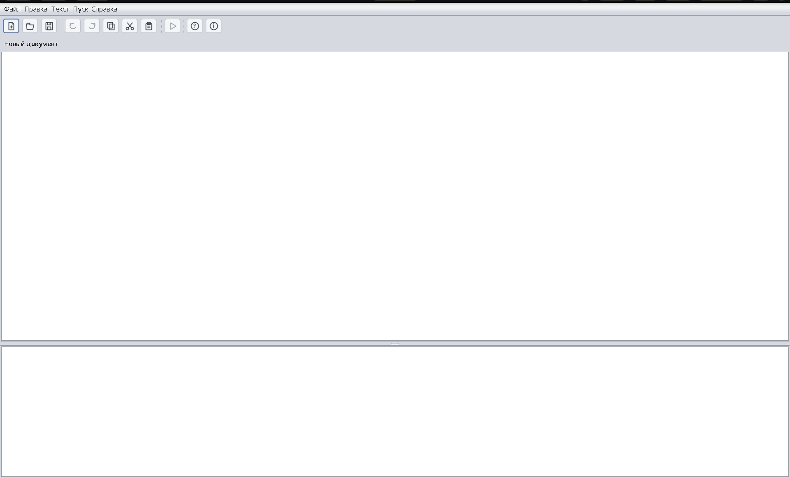
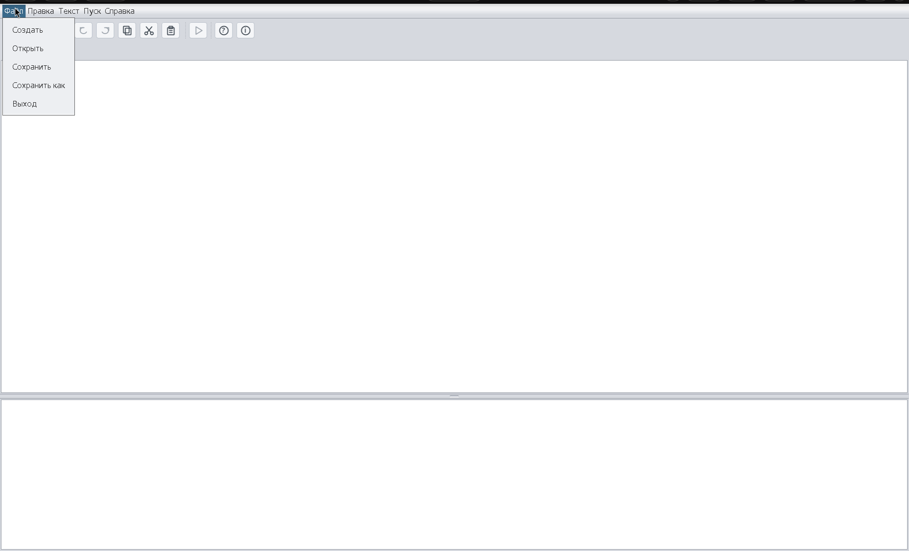
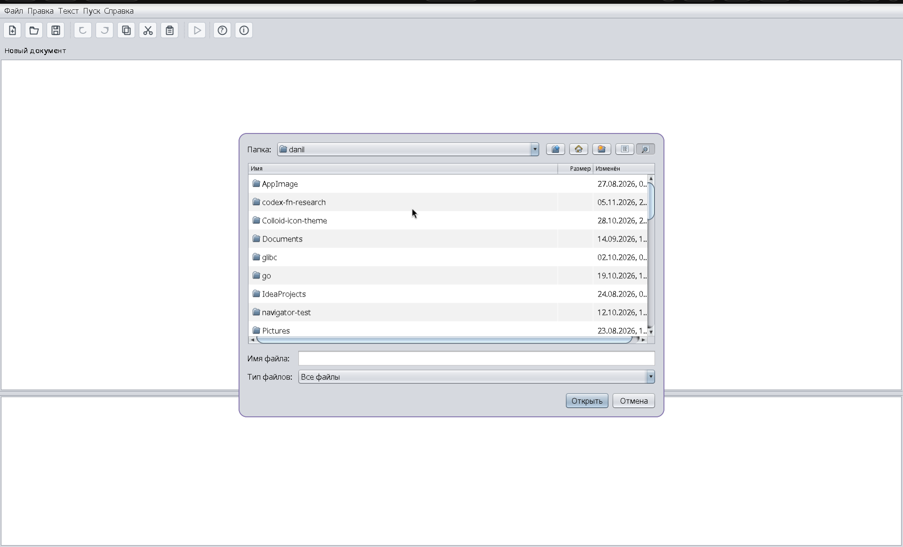
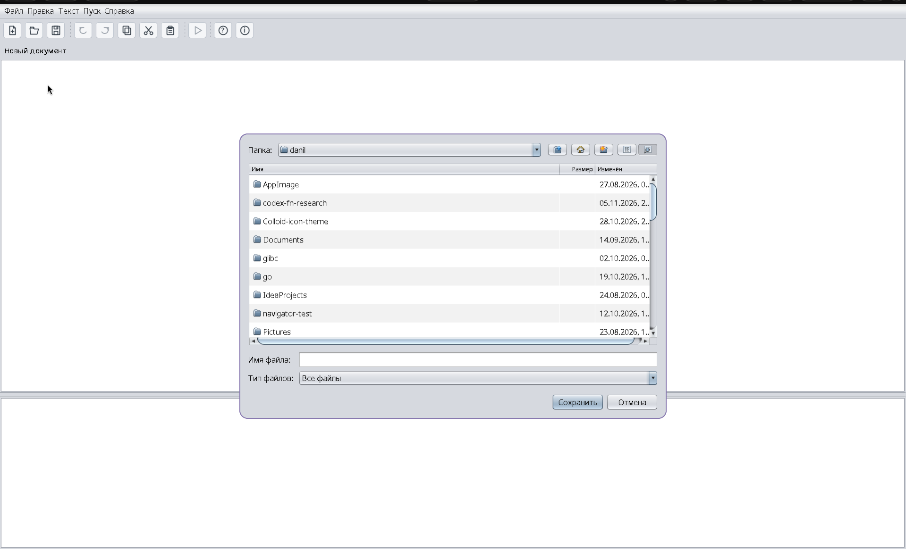
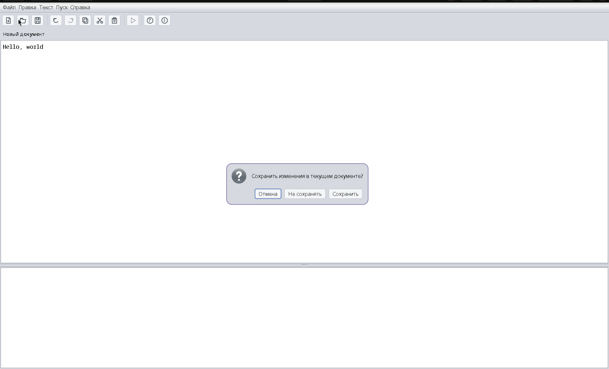
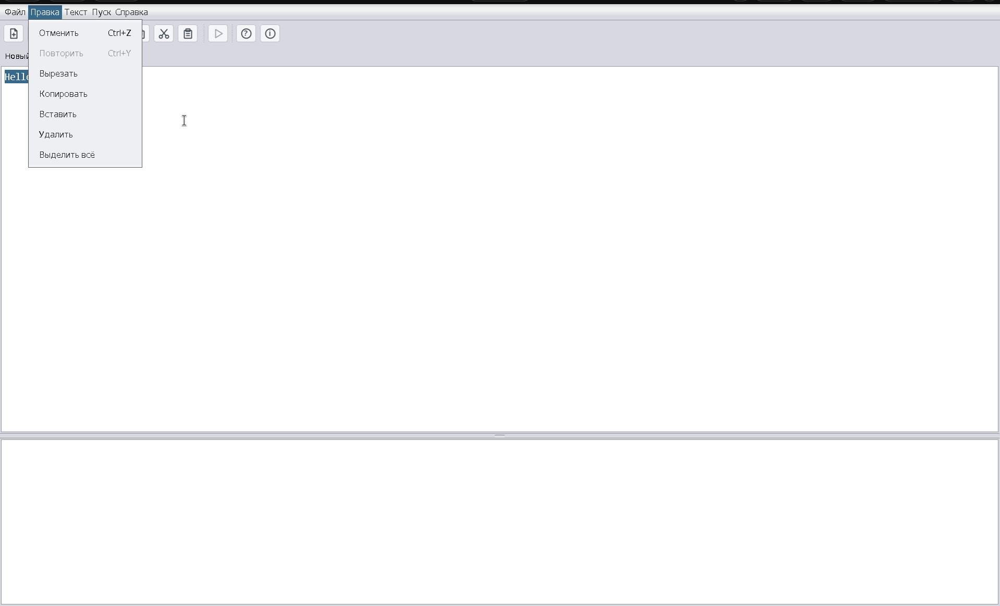
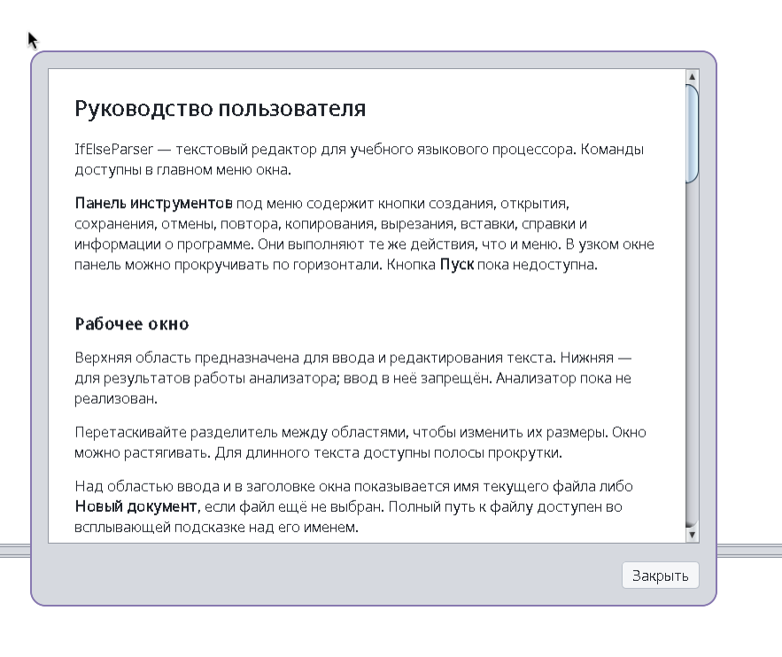
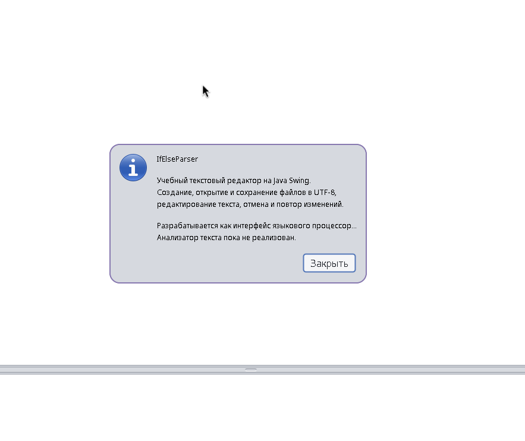

# IfElseParser

**IfElseParser** — учебный текстовый редактор с графическим интерфейсом на Java Swing, разрабатываемый в рамках дисциплины «Методы трансляции, спецификации и верификации программ».

**Автор:** Кузин Данил Сергеевич, НГУ, ФИТ, группа 24208.

Приложение предназначено для ввода и редактирования исходного текста. В дальнейшем оно будет дополнено синтаксическим анализатором условного оператора `if-else` языка Java.

## 1. Главное окно

Интерфейс содержит:

- Главное меню с командами управления редактором.
- Панель инструментов для быстрого доступа к основным действиям.
- Верхнюю область ввода и редактирования текста.
- Нижнюю область вывода результатов языкового процессора.

Область результатов доступна только для чтения. Синтаксический анализатор на текущем этапе не реализован.

Между областями расположен подвижный разделитель. Пользователь может изменять их высоту, перетаскивая его мышью. При изменении размеров окна компоненты автоматически подстраиваются под доступное пространство.

При необходимости отображаются полосы прокрутки.

Над редактором отображается имя текущего файла либо «Новый документ». Полный путь к файлу можно увидеть во всплывающей подсказке.

## 2. Меню «Файл»

Меню предназначено для работы с текстовыми файлами.

### Создать

Создаёт новый пустой документ. Содержимое редактора и области результатов очищается.

Если текущий документ содержит несохранённые изменения, приложение предлагает сохранить их перед продолжением.

### Открыть

Открывает диалог выбора файла.

После выбора файла его содержимое загружается в редактор. Используется кодировка UTF-8.

Если текущий документ изменён, перед открытием другого файла появляется предупреждение.

При отмене выбора файла или ошибке чтения текущий документ сохраняется без изменений.

### Сохранить

Сохраняет текст в текущий файл в кодировке UTF-8.

Если документ ещё не имеет пути, открывается диалог выбора имени файла.

### Сохранить как

Позволяет выбрать новое имя и расположение файла.

Если выбранный файл уже существует, приложение запрашивает подтверждение перезаписи.

После успешного сохранения новый путь становится текущим. Расширение файла необходимо указывать самостоятельно.

### Выход

Завершает работу приложения.

Если документ содержит несохранённые изменения, появляется предупреждение с возможностью сохранить данные, выйти без сохранения или отменить закрытие.

## 3. Работа с несохранёнными изменениями

Приложение отслеживает изменения текста относительно последнего сохранённого состояния.

При попытке создать новый документ, открыть другой файл или закрыть приложение доступны три варианта:

- **Сохранить** — записывает изменения и продолжает операцию.
- **Не сохранять** — продолжает операцию без сохранения.
- **Отмена** — отменяет действие и возвращает пользователя к редактированию.

Если сохранение не удалось или пользователь отменил выбор файла, исходная операция не выполняется.

Если текст снова совпадает с последним сохранённым состоянием, предупреждение не требуется.

## 4. Меню «Правка»

Меню содержит стандартные операции редактирования текста.

| Команда | Назначение |
|---|---|
| Отменить | Отмена последнего изменения текста |
| Повторить | Повтор последнего отменённого изменения |
| Вырезать | Удаление выделенного текста с помещением в буфер обмена |
| Копировать | Копирование выделенного текста |
| Вставить | Вставка текста из буфера обмена |
| Удалить | Удаление выделенного фрагмента |
| Выделить всё | Выделение всего содержимого редактора |

История отмены и повтора действует в пределах текущего документа.

После создания или открытия документа история сбрасывается. Сохранение файла историю не сбрасывает.

После нового редактирования отменённые ранее действия больше нельзя повторить.

Поддерживаются сочетания клавиш `Ctrl+Z` для отмены и `Ctrl+Y` для повтора.

## 5. Панель инструментов

Под главным меню находится панель быстрого доступа.

Она содержит кнопки создания, открытия и сохранения файлов, отмены и повтора изменений, копирования, вырезания, вставки, запуска анализатора, вызова справки и отображения информации о программе.

Кнопки используют те же команды, что и соответствующие пункты меню.

В узком окне панель может прокручиваться по горизонтали.

Команда запуска анализатора пока недоступна.

## 6. Меню «Справка»

### Вызов справки

Открывает встроенное руководство пользователя.

Руководство описывает назначение приложения, команды меню и порядок работы с документами.

Окно справки поддерживает прокрутку и изменение размеров.

Закрыть его можно кнопкой «Закрыть», клавишей Escape или стандартной командой закрытия окна.

### О программе

Отображает сведения о приложении и его назначении.

## 7. Меню «Текст» и «Пуск»

Меню «Текст» предусмотрено для отображения материалов семестрового проекта: постановки задачи, грамматики, её классификации, метода анализа, тестовых примеров, списка литературы и исходного кода.

Команда «Пуск» предназначена для запуска синтаксического анализатора.

## 8. Технологии

- Java 21+.
- Java Swing

## 9. Запуск приложения

Для запуска из исходного кода:

1. Откройте проект в IntelliJ IDEA.
2. Убедитесь, что выбран совместимый JDK.
3. Запустите класс `IfElseParser.Main`.

## 10. Текущее состояние

Реализована основная функциональность текстового редактора: управление файлами, редактирование текста, история изменений, панель инструментов и справочная система.

Дальнейшие этапы предусматривают разработку грамматики, синтаксического анализатора, диагностики ошибок и интеграцию парсера с графическим интерфейсом.